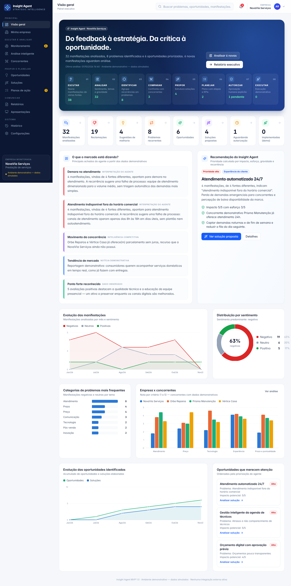

# Insight Agent

> **Do feedback à estratégia. Da crítica à oportunidade.**

Plataforma de inteligência estratégica que transforma reclamações, sugestões, avaliações, notícias e informações sobre concorrentes em **oportunidades de melhoria, soluções e planos de implementação** — com autorização humana antes de qualquer execução.

**MVP 1.0 — versão demonstrativa para apresentação acadêmica.** Todos os dados são fictícios e não há integrações externas ativas.



---

## Sumário

- [Problema](#problema)
- [Solução e proposta de valor](#solução-e-proposta-de-valor)
- [Funcionalidades](#funcionalidades)
- [Como executar localmente](#como-executar-localmente)
- [Roteiro de demonstração](#roteiro-de-demonstração-10-minutos)
- [Arquitetura](#arquitetura)
- [Tecnologias](#tecnologias)
- [Estrutura de pastas](#estrutura-de-pastas)
- [Dados demonstrativos](#dados-demonstrativos)
- [Limitações do MVP](#limitações-do-mvp)
- [Roadmap e integrações futuras](#roadmap-e-integrações-futuras)

---

## Problema

Empresas recebem diariamente reclamações, comentários em redes sociais, sugestões, avaliações, notícias do setor e sinais de concorrentes. Essas informações ficam espalhadas por várias plataformas e quase nunca viram decisões estratégicas: problemas recorrentes passam despercebidos, oportunidades de inovação se perdem e a empresa reage tarde aos movimentos do mercado.

## Solução e proposta de valor

O Insight Agent funciona como um **analista estratégico virtual**. Ele não apenas resume comentários: ele compreende o contexto, agrupa manifestações escritas de formas diferentes que apontam para o mesmo problema, avalia a gravidade, compara a empresa com concorrentes, propõe soluções, estrutura planos de implementação e apresenta tudo de forma executiva.

O diferencial é o **ciclo completo**, representado visualmente no painel:

```
ESCUTAR → ANALISAR → IDENTIFICAR → COMPARAR → PROPOR → PLANEJAR → AUTORIZAR → EXECUTAR
```

- Uma **reclamação recorrente** pode revelar uma falha estrutural.
- Uma **sugestão** de cliente pode ser uma oportunidade de inovação.
- Um **recurso de concorrente** pode ser uma vantagem competitiva a desenvolver.
- Uma **notícia** pode indicar uma mudança de mercado.

O sistema atende empresas de qualquer segmento (educação, saúde, comércio, tecnologia, serviços, transporte, alimentação etc.): o contexto da empresa é cadastrável.

## Funcionalidades

| Módulo | O que faz |
|---|---|
| **Visão geral** | Indicadores calculados a partir dos dados (manifestações, reclamações, sugestões, problemas recorrentes, oportunidades, soluções, autorizações pendentes, melhorias implementadas), 5 gráficos, “O que o mercado está dizendo?”, “Oportunidades que merecem atenção” e “Recomendação do Insight Agent”. |
| **Minha empresa** | Cadastro e edição de nome, segmento, descrição, produtos, serviços, público-alvo, diferenciais, dificuldades, recursos oferecidos e objetivos estratégicos. |
| **Monitoramento** | Central de manifestações com 11 categorias de fontes demonstrativas, cadastro manual com classificação automática, edição, exclusão com confirmação, busca e filtros (fonte, data, categoria, sentimento, prioridade, status). Botão **Analisar manifestações** com feedback por etapas. |
| **Análise inteligente** | Sentimento, classificação temática (12 categorias), agrupamento de recorrência, gravidade (baixa/média/alta/crítica) com pontuação explicada, e separação explícita entre **dados observados**, **interpretações do agente** e **hipóteses a validar**. Inclui um laboratório de classificação em tempo real. |
| **Concorrentes** | Cadastro de concorrentes, tabela comparativa por critério, gráfico, matriz de recursos e a seção **“O que os concorrentes oferecem e minha empresa ainda não oferece?”**, que transforma lacunas em oportunidades. |
| **Oportunidades** | Radar com 8 tipos de oportunidade, ranking de prioridade, **matriz impacto x esforço** interativa, status e detalhes com evidências. |
| **Soluções** | Agente de soluções: problema, contexto, análise, solução proposta, benefícios, recursos (pessoas, ferramentas, tecnologia, orçamento), complexidade, prazo, indicadores, riscos e recomendação final (implementar, testar, investigar ou descartar) — contextualizados com as evidências do sistema. |
| **Planos de ação** | Etapas com checklist, responsáveis e prazos editáveis, progresso, cronograma (Gantt), indicadores com valor atual, riscos e recursos. **Fluxo de autorização** com tela de revisão e confirmação explícita, e **execução demonstrativa** simulada. |
| **Relatórios** | Relatório executivo com capa e 14 seções construído com os dados do período selecionado; exportação em **PDF** pela impressão do navegador. |
| **Apresentações** | **Insight Presentation Builder**: 12 slides no padrão de consultoria, navegação por teclado, miniaturas, modo apresentação em tela cheia, edição de textos e exportação em **PPTX** e **PDF**. |
| **Histórico** | Auditoria de todas as ações em linha do tempo, com filtros por tipo, status, responsável e texto. |
| **Configurações** | Perfil, animações, backup/importação em JSON, restauração dos dados demonstrativos e visão da camada de provedores e integrações futuras. |

Recursos gerais: busca global, notificações, modais, mensagens de sucesso e erro, estados vazios, persistência em `localStorage` e layout responsivo (desktop e tablet).

### Autorização humana

O agente recomenda e planeja, mas **não executa nada sem autorização**:

`Em elaboração → Aguardando autorização → Aprovado → Em execução demonstrativa → Concluído` (além de `Reprovado` e `Cancelado`).

O botão **Aprovar** só é liberado após marcar *“Confirmo que revisei a proposta e autorizo sua execução demonstrativa.”* A execução é **simulada** e isso fica explícito na interface.

## Como executar localmente

Pré-requisito: **Node.js 20+**.

```bash
npm install
npm run dev        # abre em http://localhost:5173
```

Build de produção:

```bash
npm run build      # gera dist/
npm run preview
```

### Alternativa sem servidor (arquivo único)

```bash
npm run build:offline
```

Gera `dist-offline/insight-agent.html`, um arquivo único que abre com **duplo clique** no navegador — útil como plano B no dia da apresentação, sem internet nem terminal.

## Roteiro de demonstração (10 minutos)

1. **Visão geral** — apresente o ciclo ESCUTAR → EXECUTAR, os indicadores e a recomendação do agente.
2. **Monitoramento** — clique em *Adicionar manifestação*, digite por exemplo *“Fiquei horas esperando e ninguém respondeu no chat”* e mostre a prévia de classificação. Depois, *Analisar manifestações*.
3. **Análise inteligente** — abra “Demora no atendimento”: evidências com palavras diferentes agrupadas, gravidade e a separação entre observado, interpretação e hipótese.
4. **Concorrentes** — mostre a tabela comparativa e as lacunas competitivas.
5. **Oportunidades** — matriz impacto x esforço.
6. **Soluções** — selecione uma oportunidade e clique em *Gerar solução estratégica*.
7. **Planos de ação** — abra “Implantação de atendimento automatizado” → *Revisar e autorizar* → marque a confirmação → *Aprovar* → *Executar melhoria (demonstração)*.
8. **Histórico** — tudo registrado.
9. **Relatórios** e **Apresentações** — exporte o PDF e o PPTX; use *Apresentar* para tela cheia.

Para recomeçar do zero: **Configurações → Restaurar dados demonstrativos**.

## Arquitetura

```
┌────────────────────── Interface (React) ──────────────────────┐
│  pages/  →  components/ (layout, ui, charts, domínio)         │
└───────────────────────────┬───────────────────────────────────┘
                            │ useApp()
┌───────────────────────────▼───────────────────────────────────┐
│  store/AppContext — estado, ações, histórico, persistência    │
└───────────────────────────┬───────────────────────────────────┘
                            │
┌───────────────────────────▼───────────────────────────────────┐
│  services/                                                    │
│   aiProvider.ts      interface AnalysisProvider (ponto de     │
│                      troca para LLM/APIs no futuro)           │
│   analysisEngine.ts  sentimento, temas, recorrência,          │
│                      gravidade, indicadores, comparação       │
│   solutionEngine.ts  + playbooks.ts  soluções e planos        │
│   reportService.ts / presentationService.ts / pptxExport.ts   │
│   storage.ts         localStorage (trocável por API REST)     │
└───────────────────────────┬───────────────────────────────────┘
                            │
┌───────────────────────────▼───────────────────────────────────┐
│  data/  catálogo, base de conhecimento, dados demonstrativos  │
└───────────────────────────────────────────────────────────────┘
```

O **motor demonstrativo** é determinístico e local: usa léxicos de sentimento, palavras-chave por tema e uma base de conhecimento com padrões de problemas (expressões diferentes que indicam o mesmo tema). A gravidade é calculada por:

`recorrência (até 4) + impacto no cliente (1–3) + impacto operacional (0,5–1,5) + relevância estratégica (1–3) + 0,4 × registros de prioridade alta`

As telas dependem apenas da interface `AnalysisProvider`; substituir o motor local por um modelo de linguagem real exige implementar essa interface, sem reescrever a interface do usuário.

## Tecnologias

- **React 19** + **TypeScript**
- **Vite** (desenvolvimento e build)
- **Tailwind CSS v4**
- **Lucide Icons** (via `react-icons/lu`)
- **Gráficos SVG próprios** (linha/área, rosca, barras, barras agrupadas, matriz impacto x esforço), sem dependência externa
- **pptxgenjs** para exportação PowerPoint; PDF via impressão do navegador
- **localStorage** para persistência demonstrativa
- Roteamento por hash, sem dependências adicionais

> Observação: a especificação sugeria Recharts. Os gráficos foram implementados como componentes SVG próprios para reduzir dependências e manter o build offline estável; o visual e a interatividade (tooltips, legendas) foram preservados.

## Estrutura de pastas

```
insight-agent/
├── index.html
├── package.json
├── vite.config.ts
├── tsconfig.json
├── public/favicon.svg
├── scripts/build-offline.mjs      # build alternativo (esbuild + Tailwind) → arquivo único
├── docs/screenshots/              # capturas de tela
└── src/
    ├── main.tsx, App.tsx, index.css
    ├── types/                     # tipos de domínio
    ├── data/                      # catálogo, base de conhecimento, seed NovaVia
    ├── services/                  # motor de análise, soluções, relatórios, slides, provedores
    ├── store/                     # AppContext (estado + histórico) e Toasts
    ├── utils/                     # formatação e roteamento
    ├── components/
    │   ├── layout/                # Sidebar, Topbar, navegação
    │   ├── ui/                    # Card, Button, Badge, Modal, campos…
    │   ├── charts/                # gráficos SVG
    │   └── …                      # AnalysisRunner, ManifestationForm, SlideView, domínio
    └── pages/                     # 12 páginas (um módulo cada)
```

## Dados demonstrativos

A aplicação inicia com a empresa fictícia **NovaVia Serviços** (manutenção residencial e predial, segmento *Prestação de serviços*):

- 3 concorrentes fictícios: Orbe Reparos, Prisma Manutenção e Vértice Casa
- 38 manifestações (32 já analisadas e 6 pendentes, para demonstrar a análise): reclamações recorrentes, sugestões, avaliações positivas, falhas de atendimento, problemas de prazo, notícias e movimentos de concorrentes
- 8 problemas identificáveis
- 6 oportunidades
- 4 soluções propostas
- 2 planos de implementação: 1 aguardando autorização e 1 aprovado para execução demonstrativa

Todos os registros são identificados como demonstrativos. Nenhuma avaliação, fonte ou depoimento é atribuído a empresas reais; os links de origem usam domínios `.demo` fictícios.

## Limitações do MVP

- **Sem integrações reais**: não há conexão com Reclame Aqui, Instagram, Facebook, Google, YouTube, lojas de aplicativos ou portais de notícias. As fontes são categorias demonstrativas e nenhum dado é coletado automaticamente (sem scraping).
- **Sem modelo de IA externo**: a análise usa regras e base de conhecimento locais. Textos muito diferentes dos padrões conhecidos podem não ser agrupados.
- **Execução simulada**: “executar melhoria” apenas atualiza status e histórico; nada é alterado em sistemas externos, nenhuma mensagem é enviada e nada é publicado.
- **Persistência local**: os dados ficam no navegador (localStorage); não há usuários, login nem banco de dados.
- **PDF** depende do diálogo de impressão do navegador (“Salvar como PDF”).
- Valores financeiros, notas de concorrentes e indicadores são estimativas demonstrativas.

## Roadmap e integrações futuras

O MVP demonstra o conceito. Integrações externas e execução real fazem parte de versões futuras:

1. **Back-end e banco de dados** (API REST, multiempresa, autenticação e perfis de aprovação).
2. **Conectores de fontes** autorizados: APIs oficiais de redes sociais, plataformas de reputação, Google Business Profile, lojas de aplicativos, agregadores de notícias, CRM/helpdesk.
3. **Modelos de IA**: classificação semântica com LLM, agrupamento por *embeddings*, redação assistida de soluções e relatórios — implementando `AnalysisProvider`.
4. **Alertas** em tempo real para problemas críticos.
5. **Execução real com governança**: integrações com ferramentas de atendimento e gestão de projetos, sempre após aprovação humana, com trilha de auditoria.
6. **Medição de impacto**: comparar indicadores antes e depois de cada melhoria.

---

Projeto acadêmico. Dados, empresas e pessoas são fictícios.
